# Krishi Mitr

**A voice-first market assistant for Maharashtra's farmers. It tells them whether to sell their crop today or hold it, in Marathi, Hindi or English, and shows the worst case at the same size as the gain.**

[](https://krishimitr.in)


Smart India Hackathon 2026, Problem Statement 26132 (Government of Maharashtra).

> This repository is the **web build** of the Krishi Mitr mobile app. It is the same React Native source, compiled for the browser with `react-native-web`, plus two serverless voice functions. The forecasting backend lives in a separate repository and is not deployed here (see [Limitations](#limitations-and-roadmap)).

## Live demo

**https://krishimitr.in**

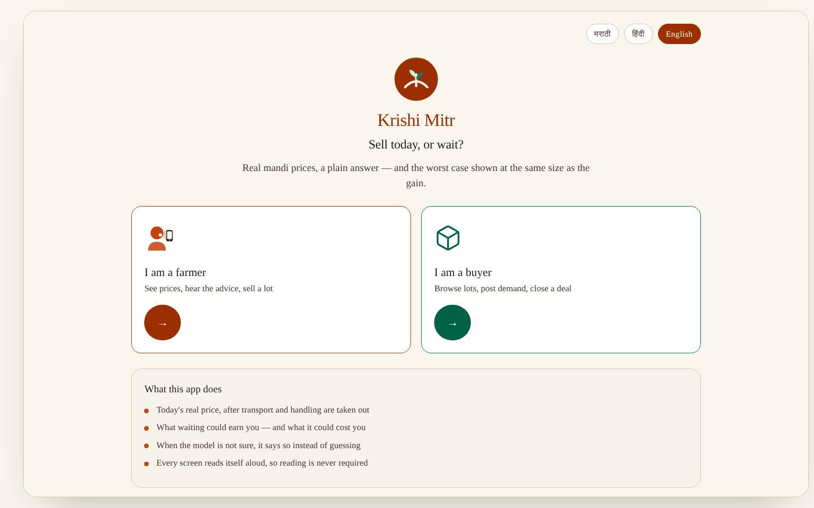

---

## The problem

A farmer bringing onions to the Lasalgaon mandi has to decide, on the day, whether to sell or to hold stock for a better price. The information that should drive that decision is:

- **in the wrong language and format.** Price portals like Agmarknet publish English tables. Many of the people who need them read Marathi, or don't read comfortably at all.
- **missing the costs that matter.** A higher gross price at a distant mandi can pay less once transport, commission, loading and storage losses are taken out.
- **one-sided.** "Prices will rise" with no downside is how a farmer ends up holding a crop that sprouts in storage.
- **hard to reach on a weak connection.** Rural mobile data drops often, and an app that shows an error screen when it does is no help in the market yard.

Krishi Mitr is built around those four gaps. Farmer screens read themselves aloud, the farmer can answer by speaking, prices are shown net of costs, the expected gain and the worst case are rendered at the same size, the model is allowed to answer "no advice", and the last data the app saw is kept on the device.

## Features, as user flows

### Farmer

1. **Voice onboarding.** Pick a language, then speak the phone number and OTP instead of typing them. The recording is transcribed in the language the farmer picked, and the digits are pulled out of the sentence, whether they come back as English words, Marathi or Hindi number words, or Devanagari numerals (`src/lib/spokenDigits.ts`). Name, district and village go through the same flow (`src/lib/registrationAgent.ts`, `src/lib/parseFarmerDetails.ts`). The keypad is always there as a fallback.
2. **Home.** Today's modal price, min/avg/max, arrivals, a 7-day bar chart, and the current recommendation with expected gain next to worst-case risk.
3. **Sell-or-hold verdict.** One of `HOLD`, `SELL_NOW`, `SELL_ELSEWHERE`, `SPLIT` or `NO_ADVICE`, with a confidence level, the data source badge, and the model's track record against a seasonal-naive baseline. The verdict is narrated as a full sentence in the farmer's language (`src/lib/verdictVoice.ts`).
4. **Cost breakdown.** Transport, commission, storage, spoilage and loading, per quintal and for the whole lot.
5. **Market prices.** Crop, district and mandi pickers, price history, a p10/p50/p90 forecast fan, and nearby mandis ranked by **net** price, not gross.
6. **Selling.** List a lot, grade it with a six-question assay, see matched buyers, bargain (capped at 3 counter-offer rounds), and follow escrow from money held through dispatch, delivery and payout.

### Buyer (trader console)

Post a demand (commodity, quantity, minimum grade, bid), see ranked matches including combined bundles of several farmers' lots with a plain-language "why", make offers, follow transactions and escrow, check data provenance, and raise disputes.

### Everywhere

- **Read-aloud on 32 of the 37 farmer screens.** A Listen button (`src/components/ui/ListenButton.tsx`) or the spoken verdict, plus optional auto-narration on arrival, off by default (`src/lib/useScreenNarration.ts`). The buyer console is text-only.
- **Three complete dictionaries.** `mr.json`, `hi.json` and `en.json` each carry the same 1,476 keys.
- **Real URLs.** Every screen has a path (`/app/home/verdict`, `/trader/matches/lot/:lot_id`), so refresh, deep links and the browser back button all work (`src/navigation/webLinking.ts`).

## Screenshots

These come from the production build of this commit (`npm run build`), served locally and captured with Playwright in headless Chromium: 1440×900 for desktop, 390×844 for mobile. The figures on screen are fixture data (see [What is real](#what-is-real-and-what-is-sample-data)).

| Voice onboarding | Farmer home |
|---|---|
| 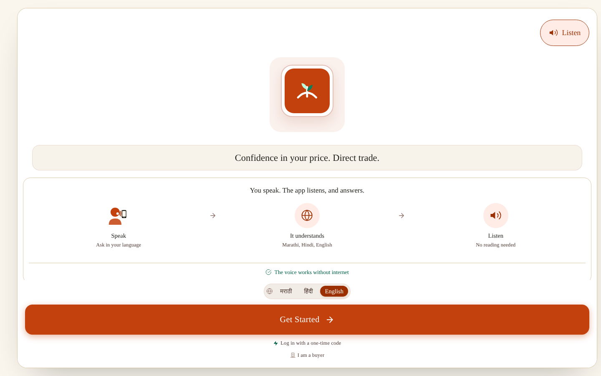 | 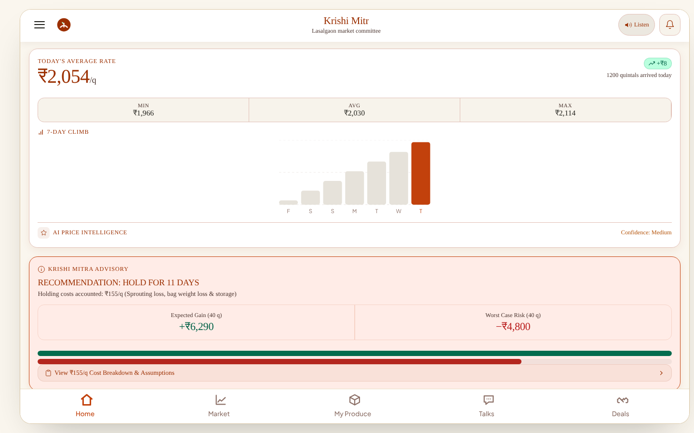 |
| **Sell-or-hold verdict** | **Cost breakdown** |
| 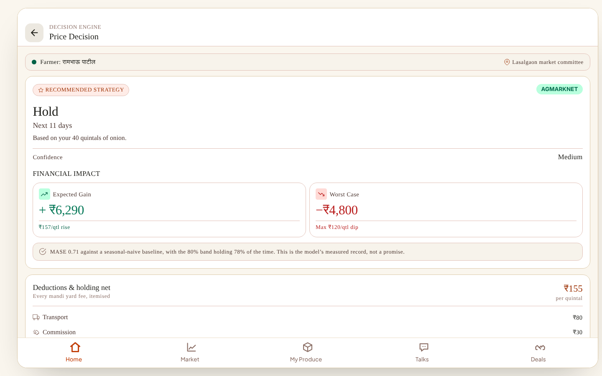 | 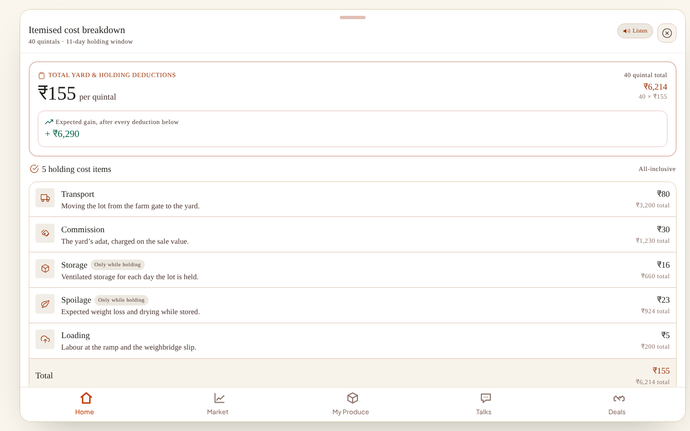 |
| **Market prices** | **Buyer console: matches** |
| 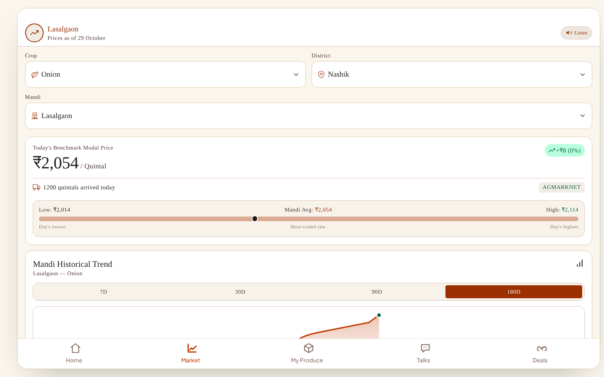 | 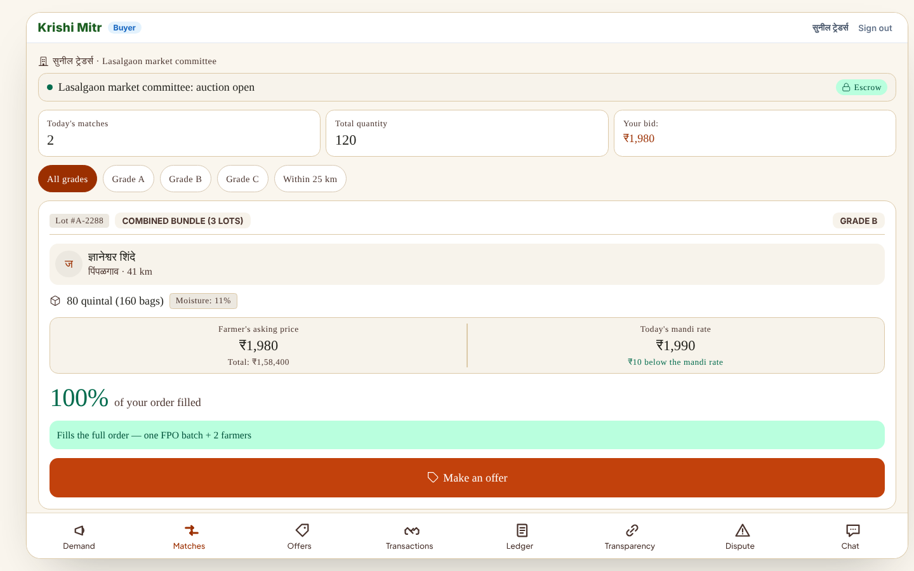 |

<p align="center">
  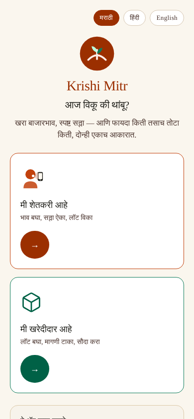
  &nbsp;&nbsp;
  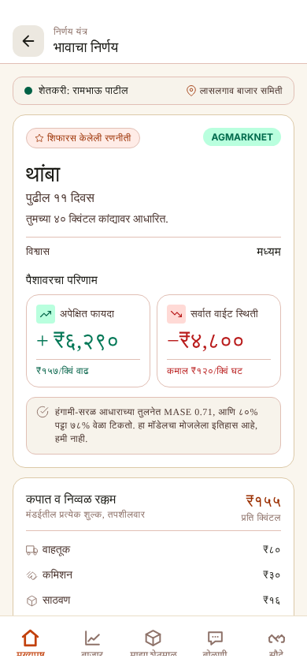
</p>
<p align="center"><em>Mobile (390 px), Marathi: landing page and verdict. Amounts are shown in Devanagari numerals.</em></p>

---

## Architecture

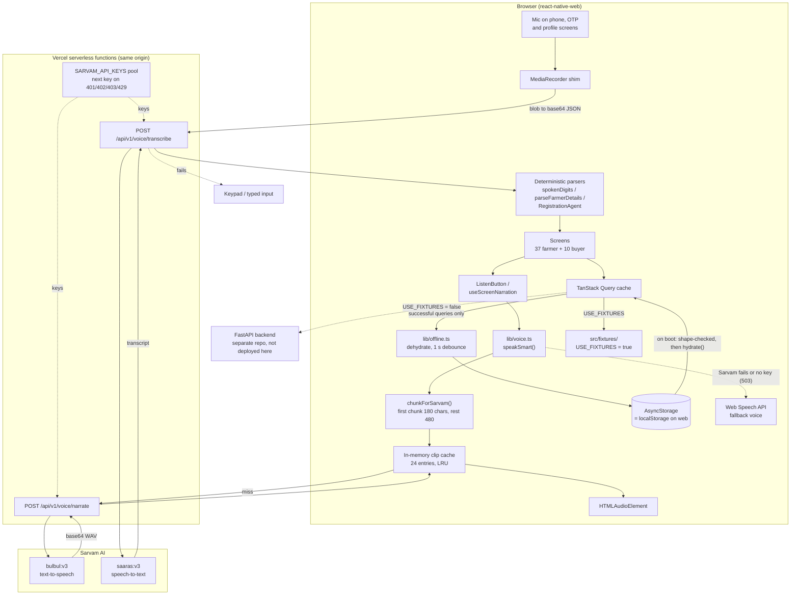

**Voice pipeline.** Speech-to-text, then deterministic parsing (no LLM), then text-to-speech:

- **TTS:** `speakSmart()` splits the narration at sentence ends (`.`, `?`, `!` and the Devanagari danda `।`). All chunks are requested at once and played in order, so the voice starts as soon as the first, shorter chunk arrives. A screen prefetches its first chunk 1.5 s after it renders, so a tap on Listen often plays from cache.
- **Fallback:** if Sarvam is unreachable, a key is missing or playback fails, the same text goes to the browser's Web Speech engine (on Android, the device TTS engine). A network failure makes the voice worse; it doesn't make it stop.
- **STT:** the browser records with `MediaRecorder`. The blob goes up as base64 JSON with the farmer's locale, and the function rebuilds it into the multipart upload Sarvam expects. The function returns both the language Sarvam detected and the one requested, so a mismatch is visible.

**Offline.** Only successful queries are written to storage, and the snapshot is shape-validated before it is hydrated, so a corrupt cache degrades to "no cache" rather than a crash. On a cold start without network, screens render the last known values with a stale banner instead of an error. The limits of this on the web are listed under [Limitations](#limitations-and-roadmap).

## Request flow: a spoken phone number

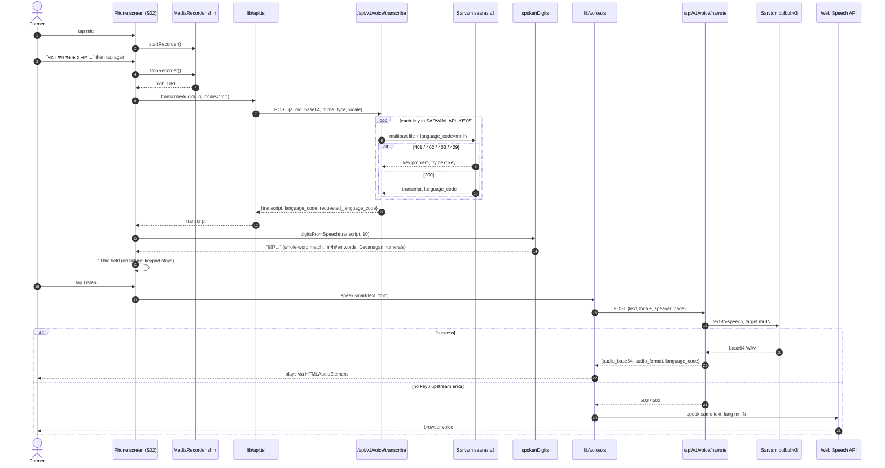

## Data model

The app's wire contract is `src/types/api.ts`. Its entities are transcribed from the project's canonical spec, and several types (for example `AssayRecord` and `DisputeDto`) are marked as column-for-column copies of the backend's Postgres DDL. The database itself is in the backend repository, so the diagram below is drawn from the client's types (the foreign keys are the `*_id` fields on those types), not from a schema file in this repo.

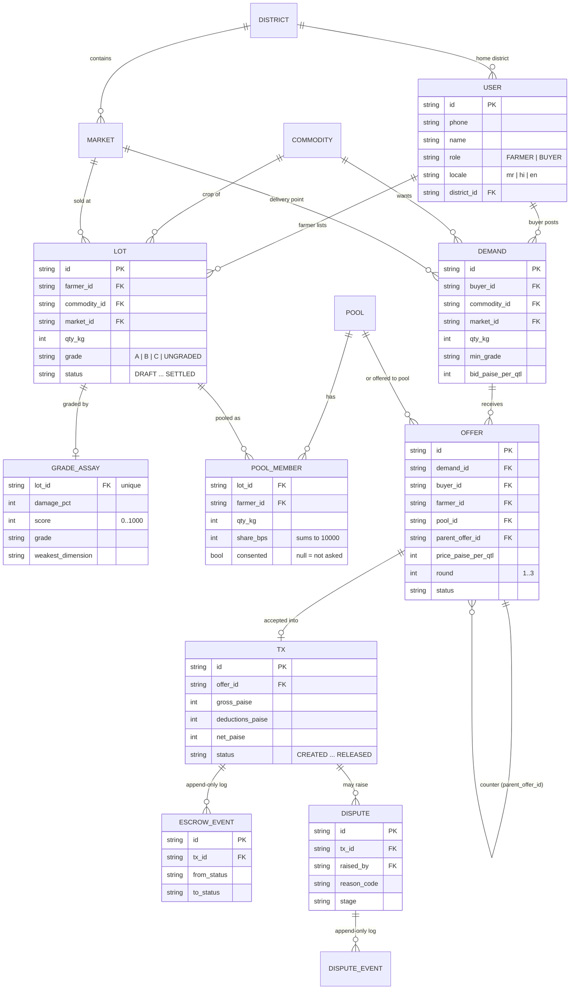

| Entity | Type in `src/types/api.ts` | What it holds |
|---|---|---|
| User | `User` | Farmer or buyer. `role` from the JWT picks the navigator; no Aadhaar anywhere. |
| District / Market / Commodity | `District`, `Market`, `Commodity` | Reference data with Marathi names. Markets carry lat/lon. Commodities carry `storable_days`. |
| Price point | `PricePoint` | Daily min/max/modal in **paise per quintal**, arrivals, and a `source` (`AGMARKNET`, `MSAMB`, `ARCHIVE`, `IMPUTED`, `SYNTHETIC`). Anything not from Agmarknet/MSAMB is badged in the UI. |
| Forecast / window | `ForecastRes`, `WindowRes` | p10/p50/p90 points; the verdict with `expected_gain_paise`, `worst_case_paise`, itemised `costs`, `refusal_reason` and the model card. |
| Lot | `LotDto` | A farmer's consignment: quantity in kg, grade, and a 9-state status. |
| Grade assay | `AssayRecord` | Six answers, a 0–1000 score and the weakest dimension. One per lot. |
| Pool / member | `PoolDto`, `SplitRow` | FPO pooling. `share_bps` sums to exactly 10,000 and `vs_solo_paise` can be negative. |
| Demand / match | `DemandDto`, `MatchDto` | Buyer orders. Matches carry `fill_bps` and a `why_mr`/`why_en` sentence, not just a score. |
| Offer | `OfferDto` | One round of bargaining. Goes either to a farmer or to a pool, never both. |
| Transaction / escrow event | `TxDto`, `EscrowEvent` | Net = gross − deductions. The timeline renders from the append-only event stream. |
| Dispute / dispute event | `DisputeDto`, `DisputeEvent` | Four reason codes, seven stages, append-only. |

**On-device storage** (AsyncStorage, which is `localStorage` in the browser):

| Key | Contents |
|---|---|
| `offline.query-cache.v1` | Dehydrated TanStack Query cache (successful queries only) |
| `auth.token` | JWT (plain AsyncStorage for now; see Limitations) |
| `auth.user.v2` | Last signed-in user, so a cold start without network keeps the farmer signed in |
| `app.locale` | `mr` / `hi` / `en` |
| `app.selection` | Last picked crop, district and mandi |
| `app.autoNarrate`, `app.voice`, `app.voiceSpeed` | Voice settings |

## Tech stack

| Part | Tool | Why |
|---|---|---|
| App / frontend | React Native 0.76 + **react-native-web 0.19**, React 18.3, TypeScript 5.0 | One codebase for the Android app and the website. A separate web rewrite of these screens would drift from the app. |
| Navigation | React Navigation 7 (native-stack, bottom-tabs) with a web linking config | Native stacks on the phone, real URLs and back-button behaviour in the browser. |
| Charts | react-native-svg | Price history and the forecast fan, drawn the same way on both platforms. |
| Backend / API | Vercel serverless functions (`api/v1/voice/*`) | The only server-side need on the web is voice. Running it server-side keeps the Sarvam keys out of the JS bundle. The response shape matches the FastAPI backend's `NarrateRes`, so `lib/api.ts` doesn't change. |
| Voice / AI | Sarvam AI `saaras:v3` (STT) and `bulbul:v3` (TTS); Web Speech API as the fallback | Sarvam covers Marathi and Hindi. The browser engine keeps narration working when Sarvam is down. |
| Native-module shims | `src/web-shims/` over Web Speech, `HTMLAudioElement`, `MediaRecorder`, `<input capture>`, an in-memory file map | Five native modules have no browser build. Each shim exposes the same API, so no screen code changes. |
| Data fetching | TanStack Query 5 | Caching, retry policy (4xx responses are never retried), and the hydrate/dehydrate hooks that offline persistence needs. |
| Offline storage | AsyncStorage (localStorage on web) + hand-written persistence in `lib/offline.ts` | Uses Query's built-in `dehydrate`/`hydrate` instead of adding the persist-client package. |
| Auth / security | Phone + OTP, then a JWT; keys only in Vercel env vars; `.env*` git-ignored | The bundle holds no secrets. In this deployment the sign-in uses fixture accounts. |
| Build | webpack 5 + Babel (preset-env/react/typescript) | Aliases `react-native` and the native modules to the web shims. |
| Testing | Jest 29 + React Native Testing Library: **363 tests in 30 suites, all passing**, in the [mobile source repo](https://github.com/Zakuroooo/Oneforall-Farmers/tree/pranay/app) | This web repo adds a build and a headless smoke run (see [Testing](#testing)). |
| CI / deploy | Vercel builds `npm run build` → `dist/`, with SPA rewrites in `vercel.json`. No CI workflow is set up. | |

## Project structure

```
.
├── App.tsx                 # Providers, QueryClient (retry policy), offline hydrate/persist
├── index.web.js            # Web entry; full-height root and desktop width/zoom steps
├── api/v1/voice/           # Vercel functions: narrate.ts (TTS), transcribe.ts (STT)
├── src/
│   ├── screens/farmer/     # 37 farmer screens (onboarding, home, verdict, lots, deals ...)
│   ├── screens/buyer/      # 10 buyer-console screens
│   ├── screens/web/        # Landing.tsx, the only web-only screen
│   ├── components/         # UI kit, farmer cards, charts (price history, forecast fan)
│   ├── navigation/         # Stacks, tabs, and webLinking.ts (URL for every screen)
│   ├── lib/                # voice, api client, offline cache, i18n, speech parsers, money/dates
│   ├── web-shims/          # Browser stand-ins for the 5 native modules
│   ├── fixtures/           # Wire-contract-shaped sample data used while USE_FIXTURES = true
│   ├── i18n/               # mr.json, hi.json, en.json (1,476 keys each)
│   ├── types/api.ts        # The wire contract
│   └── theme/tokens.ts     # Design tokens
├── public/                 # index.html, icons, manifest, og-image, video.html
├── scripts/                # copy-static.js (public/ → dist/), og-image.html
├── webpack.config.js
└── vercel.json             # Build command, output dir, SPA rewrites
```

## Getting started

**Prerequisites:** Node.js 18 or newer (`engines` in `package.json`). The commands below were run on Node 22.22.

```bash
npm ci
npm start          # dev server on http://localhost:8080
npm run build      # production bundle in dist/ (webpack, then scripts/copy-static.js)
```

**Environment variables** (names only; set them in Vercel → Project Settings → Environment Variables, see `.env.example`):

| Name | Used by | Purpose |
|---|---|---|
| `SARVAM_API_KEYS` | `api/v1/voice/*` | Comma-separated pool of Sarvam keys, tried in order |
| `SARVAM_API_KEY` | `api/v1/voice/*` | Optional single-key alternative |

Without a key, both functions return `503 NO_VOICE_KEY`. The app then falls back to the browser voice and the keypad, so it is fully usable without one.

The `/api` functions run only on Vercel (or under `vercel dev`). `npm start` serves the front end alone, so voice calls fall back to the browser engine there.

## Testing

**Unit and screen tests live in the mobile source repo** ([Oneforall-Farmers / app](https://github.com/Zakuroooo/Oneforall-Farmers/tree/pranay/app)), because this repo is only the web build of that source.

| Mobile source tests (`cd app && npx jest`) | Result |
|---|---|
| Test suites | **30 of 30 pass** |
| Tests | **363 of 363 pass** (Jest 29 + React Native Testing Library; native modules such as AsyncStorage, react-native-fs, sound and TTS are mocked in `jest.setup.js`) |
| Covers | pure modules (`spokenDigits`, `chunkForSarvam`, `numberWords`, `RegistrationAgent`, money), farmer and buyer screens (verdict, counter-offer, pool split, dispute, data provenance), and the app shell |

What was run on this web repo:

| Check | Result |
|---|---|
| `npm ci` | Installs cleanly |
| `npm run build` | Compiles successfully in about 17 s. Main bundle 1.3 MiB minified; 8 static files copied to `dist/` |
| `npm run typecheck` | **Fails before checking any file.** `tsconfig.json` extends `@react-native/typescript-config` and references `jest` types, and neither is a dependency of this web repo |
| Headless Chromium smoke run of the production build | Landing, onboarding, farmer home, verdict, cost breakdown, market prices, my lots, deals, model card, and five buyer-console routes all mounted with no page errors |
| Offline persistence | After the farmer home loads, `offline.query-cache.v1` holds 3 queries (about 29.8 KB) in `localStorage` |

## Key engineering decisions

| Decision | Why |
|---|---|
| **Compile the mobile source for the web** instead of writing a second front end | One set of screens, dictionaries and fixtures. The website can't silently become a different product from the app. |
| **Shim native modules, not screens** | Every screen still imports `react-native-tts`, `react-native-sound` and the others. webpack points those imports at browser implementations. |
| **Voice keys behind a same-origin function** | Anything in a JS bundle is public. The function also normalises Sarvam's response to the backend's contract. |
| **Deterministic speech parsing, not an LLM** | A phone number, OTP or district has to be right, not plausible. Parsers either return a value or decline. The in-app assistant is canned Q&A on purpose. |
| **Money in integer paise, quantities in kg, rates in basis points** | No floating-point rupees anywhere in the contract. |
| **Show the worst case and allow "no advice"** | The verdict renders `worst_case_paise` at the same size as the gain, and `NO_ADVICE` is a first-class answer when the forecast band is too wide. |

## Challenges and fixes

Each of these is documented at the fix site in the code.

| Symptom | Root cause | Fix |
|---|---|---|
| Server voice silently fell back to the robotic voice for a whole afternoon | A Sarvam key ran out of credit (`402`) and nothing reported it | Key pool with rotation on 401/402/403/429; the function returns an explicit error code (`api/v1/voice/narrate.ts`) |
| Long narrations always used the fallback voice | Sarvam rejects input over 500 characters | Sentence-aware chunking with a 480-character cap, including the danda `।` (`chunkForSarvam`) |
| A noticeable wait before the first word | Waited on `Promise.all` for every chunk | Fetch all chunks together and play each one as it arrives; shorter first chunk; prefetch on render; LRU clip cache |
| Spoken Marathi numbers left the phone field empty | `replace(/\D/g, '')` drops Marathi number words and Devanagari numerals | Whole-word digit matching across mr/hi/en (`spokenDigits.ts`). Whole words also stop "ph**one**" from adding a stray 1 |
| Marathi speech transcribed as English or nothing | Wrong or missing `language_code` sent to the recogniser | Send the farmer's locale on every request; return detected vs requested language |
| Mic "worked" in the browser but every transcript was empty | A browser `FormData` serialises RN's `{uri,type,name}` object as `"[object Object]"` | The web path reads the blob, posts base64 JSON, and the function rebuilds the multipart upload |
| Listen button stuck on "Playing…" | `react-native-tts`'s typings say `speak()` returns an id; on Android it returns a Promise, so the completion check never matched | Await the id, honour early completions, 60 s guard timer (`speakViaTts`) |
| Blank page on first web deploy | `react-native-web` has no `PermissionsAndroid` | A `react-native` alias that adds the missing export (`src/web-shims/react-native.ts`) |
| Refresh dumped users back on the landing page | Navigation state lived only in memory | A URL for every screen through React Navigation linking (`webLinking.ts`) |

## What is real and what is sample data

- **Real:** every screen and interaction, the three languages, the voice pipeline (Sarvam STT/TTS through the serverless functions when a key is set, the browser voice otherwise), URL routing and the offline query-cache persistence.
- **Sample data:** `USE_FIXTURES = true` in `src/config.ts`. All prices, forecasts, verdicts, lots, offers and model-card numbers (for example the MASE 0.71 on the verdict screen) come from `src/fixtures/` and **are not live measurements**. The landing page says so: "हे प्रात्यक्षिक आहे. आकडे नमुना आहेत." ("This is a demo. The figures are samples.")

## Limitations and roadmap

- **No live data in this deployment.** The forecasting service and the FastAPI backend aren't deployed with this site. Setting `USE_FIXTURES = false` compiles against real `lib/api` calls, but three endpoints still have open contract questions (`GET /buyers/{id}`, `GET /tx`, `tx_id` on an accepted offer).
- **Offline is partial on the web.** The data cache survives, but there's no service worker, so with no network a cold page load fails before the app starts (`net::ERR_INTERNET_DISCONNECTED` in a headless test). Next step: a service worker that precaches the app shell.
- **The fallback voice depends on the browser.** Web Speech coverage of Marathi and Hindi varies by device and browser, and some browser voices need the network themselves. The bundled offline Marathi clips the native engine is designed for aren't recorded yet, so that path also uses the device TTS engine today.
- **Tests run in the mobile source repo, not here.** The 363 Jest tests live with the source; this web repo has no CI yet, and `npm run typecheck` needs a standalone `tsconfig` here (see [Testing](#testing)). Next: a GitHub Actions workflow that runs the source tests and this build on every push.
- **Token storage.** The JWT sits in plain AsyncStorage. The planned move is to `react-native-keychain` on Android.
- **Bundle size.** The main bundle is 1.3 MiB minified, and three hero JPEGs are 750 KB–1 MB each. Code splitting by navigator and recompressing those images would cut first-load time on rural networks.
- **No license file.** All rights reserved until one is added.

---

Built by **Pranay Sarkar** ([@Zakuroooo](https://github.com/Zakuroooo)) for Smart India Hackathon 2026.
